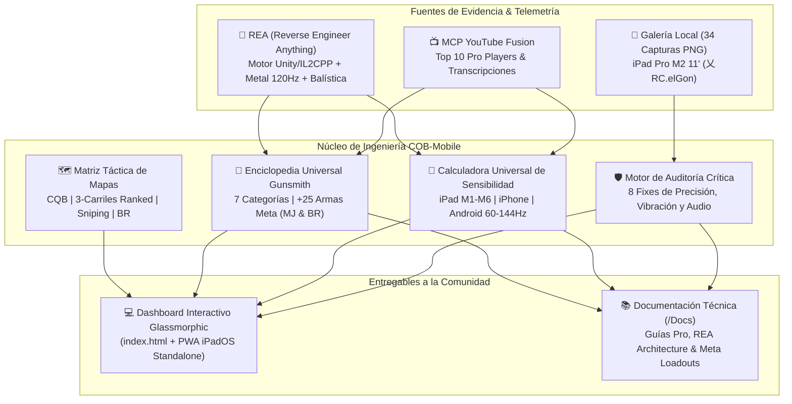

# Call of Duty: Mobile — Pro Command Center, REA Telemetry & Universal Gunsmith (`COB-Mobile`)

[](https://github.com/rogerrcarvajal)
[](https://github.com/rogerrcarvajal)
[](https://github.com/rogerrcarvajal/REA)
[](https://github.com/rogerrcarvajal)
[](https://antigravity.google)

> **Desarrollador Líder:** Rogerr Carvajal ([@rogerrcarvajal](https://github.com/rogerrcarvajal)) — *Player ID:* `乂RC.elGon`  
> **Dispositivo Base de Laboratorio:** iPad Pro 11" (4th Gen) Chip M2 Wi-Fi 256GB (`2388 × 1668 px @ 120Hz ProMotion`)  
> **Alcance Universal:** Multi-Dispositivo (**iPad Serie M [M1, M2, M4, M5, M6 Mini 8]**, **iPad Air/Base**, **iPhone ProMax 120Hz**, **Android Gaming 120/144Hz & 60Hz**) + **Armero Universal Meta (25+ Armas para MJ & BR)**  

---

## 🎯 1. Visión General del Proyecto

**`COB-Mobile`** es una suite interactiva de alto rendimiento, centro de mando táctico y enciclopedia de armero (*Gunsmith*) para **Call of Duty: Mobile (Activision / TiMi Studio Group)**.

Este proyecto nace de tres pilares de ingeniería combinados:
1. **Auditoría Visual Exhaustiva (`COD Mobile - Gallery`)**: Análisis directo de las **34 capturas de configuración real** (`IMG_0254.PNG` – `IMG_0287.PNG`) tomadas en un **iPad Pro M2 11" (4th Gen)** a 120 FPS Ultra, identificando y corrigiendo los 8 cuellos de botella críticos que limitan la precisión y movilidad.
2. **Inteligencia Competitiva vía MCP YouTube (`youtube-fusion`)**: Extracción automatizada de telemetría, transcripciones y configuraciones de los **TOP 10 Pro Players y Creadores de Contenido** mundiales (*Ganyth, LittleB [3x World Champ], Coscript, samiul gamer, NightYT, ALVI GAMING, dry, SantanaGlock, IceyJoe, Space, MYAWOLLS, BREY A.D, Jonhsoldier HD*).
3. **Ingeniería Inversa de Motor & Armero Universal (REA — *Reverse Engineer Anything*)**: Deconstrucción de la arquitectura interna del cliente **iPadOS ARM64 (`UnityFramework` Mach-O + `libil2cpp` + `Metal API`)** y del modelo matemático de balística (*Bullet Spread Accuracy [BSA]*, *Hit-Flinch*, *ADS Frame Rounding a 120Hz*, *Aim Assist Magnetic Cone* y *Damage Range Drop-off*), permitiendo que **cualquier jugador en cualquier dispositivo (iPad, iPhone o Android)** aplique las mejores clases para dominar en **Multijugador (MJ)** y **Battle Royale (BR)**.

---

## 🏗️ 2. Arquitectura del Ecosistema



---

## 📂 3. Estructura del Repositorio

```text
COB-Mobile/
├── index.html                                    # Dashboard Interactivo Universal (PWA + Glassmorphic UI)
├── manifest.webmanifest                          # Manifiesto PWA para instalación nativa en iPad Pro M2 / iOS / Android
├── README.md                                     # Documentación principal de impacto
├── COD Mobile - Gallery/                         # 34 capturas reales (IMG_0254.PNG a IMG_0287.PNG) del iPad Pro M2
└── Docs/                                         # Documentación Técnica Especializada para la Comunidad
    ├── 01-TOP10-PRO-SETTINGS-MJ-BR.md            # Auditoría de las 34 capturas y Plan Maestro MJ & BR
    ├── 02-UNIVERSAL-META-WEAPONS-GUNSMITH.md     # Enciclopedia de Clases (AR, SMG, Sniper, LMG, Escopetas, Tácticos)
    ├── 03-REA-ENGINE-TELEMETRY-IPAD-M-SERIES.md  # Ingeniería Inversa REA del motor Unity/Metal y Balística
    └── 04-TACTICAL-MAP-PLAYBOOK.md               # Guía de mapas competitivos MJ Ranked y zonas de Battle Royale
```

---

## 🚨 4. Los 8 Hallazgos Críticos de la Auditoría (`COD Mobile - Gallery`)

Al contrastar las capturas originales (`IMG_0255.PNG` – `IMG_0285.PNG`) con la telemetría del **TOP 10 Pro Lead**, estos son los **8 ajustes obligatorios** que transforman inmediatamente el *aim* y el movimiento en cualquier dispositivo:

| # | Captura Auditada | Ajuste en el Juego | Valor Original Detectado | Valor Pro Recomendado | Impacto Real en Partida |
| :---: | :---: | :--- | :---: | :---: | :--- |
| **1** | [`IMG_0269.PNG`](COD%20Mobile%20-%20Gallery/IMG_0269.PNG) | **Escala de vibración de la cámara (ADS)** | `100` ❌ | **`0`** ✅ | Elimina el temblor visual de toda la pantalla al disparar ráfagas con AK-47, AK-117 o Oden. |
| **2** | [`IMG_0281.PNG`](COD%20Mobile%20-%20Gallery/IMG_0281.PNG) | **Sensibilidad de Disparo — Dirección** | `300` ❌ | **`128` (MJ) / `135` (BR)** ✅ | Corrige el desvío brusco al tocar el botón de disparo o disparar desde la cadera. |
| **3** | [`IMG_0282.PNG`](COD%20Mobile%20-%20Gallery/IMG_0282.PNG) | **Sensibilidad de Disparo — Giro Vertical** | `85` ❌ | **`122` (MJ) / `125` (BR)** ✅ | Convierte cualquier fusil de alto retroceso en un láser deslizando apenas `1 cm` el dedo hacia abajo. |
| **4** | [`IMG_0279.PNG`](COD%20Mobile%20-%20Gallery/IMG_0279.PNG) | **Vincular sensibilidad con resolución & Rotación** | `SÍ` / `Acel. 190` ❌ | **`NO` / `Vel. Fija` (o `Acel. 100`)** ✅ | Protege la memoria muscular para *quickscopes* con el **HDR**, **DLQ33** y **Tundra**. |
| **5** | [`IMG_0280.PNG`](COD%20Mobile%20-%20Gallery/IMG_0280.PNG) | **Sensibilidad de Cámara — Mira Táctica X4** | `295` ❌ | **`70` (MJ) / `75` (BR)** ✅ | Corrige el salto involuntario al usar miras medias en Battle Royale. |
| **6** | [`IMG_0270.PNG`](COD%20Mobile%20-%20Gallery/IMG_0270.PNG) | **Perspectiva de compañero** | `NO` ❌ | **`SÍ`** ✅ | Habilita visión de siluetas aliadas a través de muros para predecir *spawns* y flanqueos. |
| **7** | [`IMG_0258.PNG`](COD%20Mobile%20-%20Gallery/IMG_0258.PNG) | **Pista de deslizamiento & Disparo Manual** | `NO` / `1 Toque SÍ` ❌ | **`SÍ` / `Cadera (Manual)`** ✅ | Elimina el error de quedarse agachado (*dead-slide*) y reduce `80 ms` el tiempo de reacción al apuntar. |
| **8** | [`IMG_0276.PNG`](COD%20Mobile%20-%20Gallery/IMG_0276.PNG) | **Efectos de Sonido, Música y Dolby Atmos** | `60 / 35 / NO` ❌ | **`100 / 0 / SÍ`** ✅ | Prioriza al 100% los pasos enemigos, recargas y placas con audio espacial 3D. |

---

## 🔫 5. Resumen del Armero Universal (Gunsmith Meta — Todas las Categorías)

Las armas no dependen del dispositivo: dependen de una **combinación matemática de accesorios** que optimice el *Time-To-Kill (TTK)*, la *Dispersión de Balas al Apuntar (BSA)* y la *Movilidad*. En el **[Dashboard Interactivo](index.html)** y en [`Docs/02-UNIVERSAL-META-WEAPONS-GUNSMITH.md`](Docs/02-UNIVERSAL-META-WEAPONS-GUNSMITH.md) encontrarás las clases completas para **MJ** y **BR** de:

* **🔥 Tus 3 Armas Insignia (Prioridad Absoluta)**:
  * **AK-47**: *Híbrida Agresiva Gru / Calibre 5.45* (MJ) y *Laser Beam Ranger 50 Balas* (BR).
  * **AK-117**: *Slayer Ranked Sin Culata + Monolítico* (MJ) y *Meta Absoluto Marksman 48 Balas* (BR).
  * **HDR Sniper**: *Quickscope FTAC Stalker-Scout + FMJ* (MJ) y *Hitscan 68.3cm Pro + FTAC Champion + Hiriente* (BR).
* **⚔️ Fusiles de Asalto (AR) Meta TOP**: **BP50**, **Oden**, **DR-H** *(Cargador OTM 25/30)*, **HVK-30** *(Gran Calibre)*, **Type 19**, **Kilo 141**, **Grau 5.56**, **M13**, **XM4**.
* **⚡ Subfusiles (SMG) para Ramonear / Rush**: **USS 9**, **CX-9**, **Fennec**, **Switchblade X9**, **CBR4**, **QQ9** *(10mm)*, **MAC-10**.
* **🎯 Francotiradores & Tiradores (Sniper / Marksman)**: **LW3-Tundra**, **DL Q33**, **Locus**, **Koshka**, **SKS**, **Type 63**.
* **🛡️ Ametralladoras Ligeras (LMG) & Escopetas (One-Pump)**: **MG42**, **RPD** *(Cañón de Refrigeración Infinita)*, **Holger 26**, **KRM-262**, **HS0405**, **R9-0**.

---

## 🚀 6. Cómo Usar el Dashboard Interactivo (Local, GitHub & iPad Pro M2)

1. **En tu Servidor Local XAMPP**:
   Abre en tu navegador: `http://localhost/COB-Mobile/` o abre directamente [`index.html`](index.html).
2. **En tu iPad Pro M2 (Modo App Nativa PWA)**:
   Accede a la URL del repositorio o servidor local desde **Safari en iPadOS**, toca **Compartir → Agregar a pantalla de inicio**, y tendrás el **COD Mobile Pro Command Center** a pantalla completa (`120Hz`) junto a tu juego en **Stage Manager / Slide Over**.

---

## 📖 7. Índice de Documentación en `/Docs`

1. 📄 **[`Docs/01-TOP10-PRO-SETTINGS-MJ-BR.md`](Docs/01-TOP10-PRO-SETTINGS-MJ-BR.md)**: Guía paso a paso de configuración Básica, Controles, Gráficos, Audio y Sensibilidad para iPad Serie M, iPhone y Android.
2. 📄 **[`Docs/02-UNIVERSAL-META-WEAPONS-GUNSMITH.md`](Docs/02-UNIVERSAL-META-WEAPONS-GUNSMITH.md)**: Enciclopedia completa de las **mejores clases de todas las armas** del juego para MJ y BR.
3. 📄 **[`Docs/03-REA-ENGINE-TELEMETRY-IPAD-M-SERIES.md`](Docs/03-REA-ENGINE-TELEMETRY-IPAD-M-SERIES.md)**: Análisis de ingeniería inversa (**REA**) sobre el motor Unity/Metal de COD Mobile, *Frame-Rounding* a 120 FPS, muestreo táctil de 240Hz y fórmulas internas del Armero.
4. 📄 **[`Docs/04-TACTICAL-MAP-PLAYBOOK.md`](Docs/04-TACTICAL-MAP-PLAYBOOK.md)**: Estrategia de rotación, *head-glitches*, selección de arma por mapa en MJ Ranked y zonas de aterrizaje en *Isolated*, *Blackout* y *Alcatraz*.

---

<div align="center">
  <sub>Diseñado y auditado con rigor de ingeniería por <strong>Rogerr Carvajal (@rogerrcarvajal)</strong> • Impulsado por <strong>Google Antigravity</strong>, <strong>REA</strong> & <strong>YouTube MCP Fusion</strong></sub>
</div>